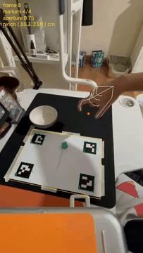
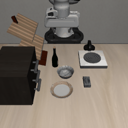
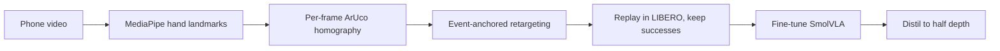
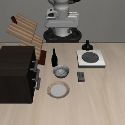
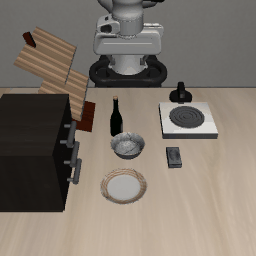
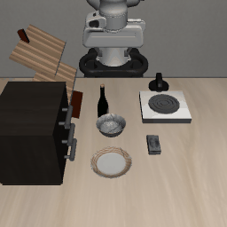
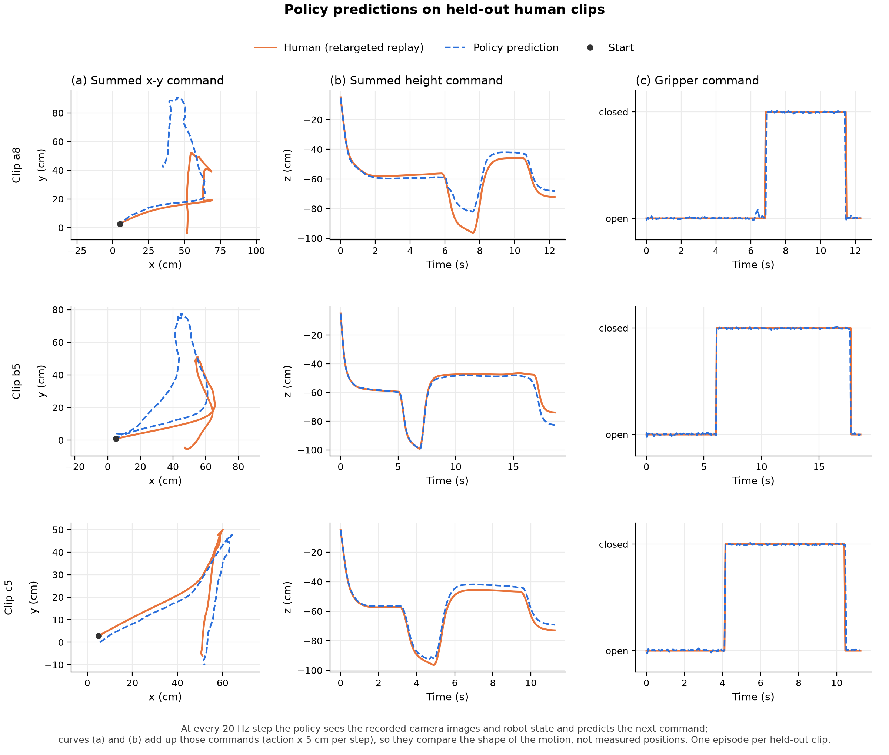
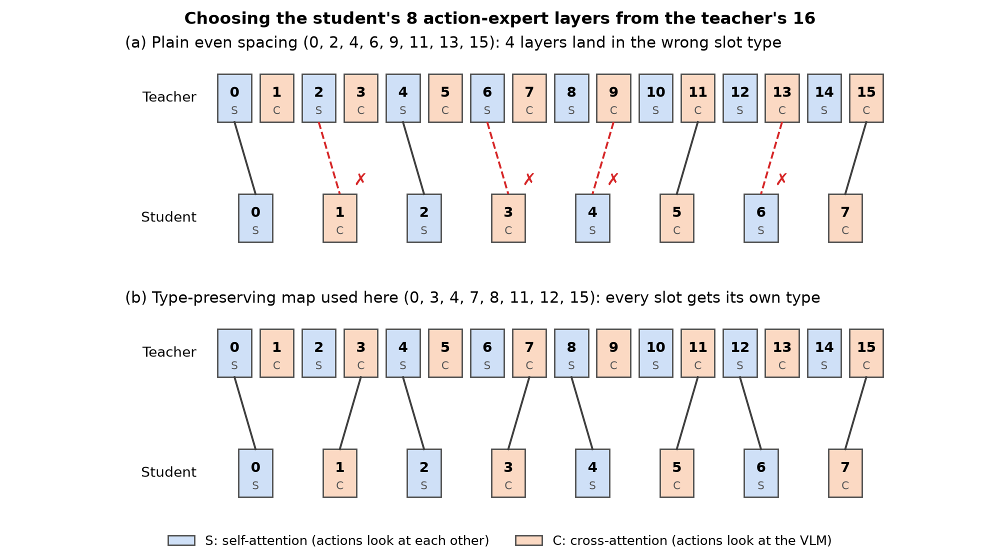
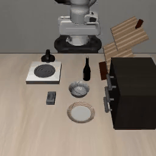

# ego2panda

This project turns egocentric phone videos of a human hand putting a cube in a bowl into robot demonstrations in LIBERO. These demonstrations fine-tune SmolVLA to 92% (23/25) success on LIBERO-Goal start states it never trained on. A half-depth student distilled from the fine-tuned model keeps 92% success and cuts the time per action chunk from 128 ms to 73 ms. <!-- results/eval/smolvla_ego2panda_n10.json, results/distill/eval_student_n10.json, results/distill/speed.json -->

<table>
<tr>
<td align="center"></td>
<td align="center"></td>
</tr>
<tr>
<td width="40%" valign="top"><em><b>Data collection:</b> one egocentric clip of the pick-and-place task. The ArUco markers give the table plane in every frame, so a homography maps image pixels to centimetres on the table. White skeleton overlay is the MediaPipe hand gesture detection and the red dot is the pinch point that becomes the gripper position.</em></td>
<td width="60%" valign="top"><em><b>Output:</b> LIBERO-Goal task 6, "put the cream cheese in the bowl". This project's fine-tuned policy picks up the cream cheese box and places it in the black bowl, from a start state it never trained on (success at step 194). The policy never lets go, because its training demos end at success, so the last 2 s are a scripted release (open, then lift) to show the box in the bowl. LIBERO has no cube, so this is the closest task to the recordings of picking up a cube and putting it into a bowl.</em></td>
</tr>
</table>


## The question

Robot demonstrations need a robot and a teleoperator; phone video of a human hand completing tasks is cheap and can be done solo at home. Can a few dozen phone clips, converted into robot demonstrations, train a vision-language-action policy that succeeds in simulation? 

This project tests this by evaluating the trained model on 25 layouts of a LIBERO task that it never saw in training.

## Robot and action space

Recorded videos show where a hand goes and when it grips, not what a robot's joints should do. LIBERO makes that easy to use: the policy does not move the Panda's 7 joints itself. It only says where to move the end effector, and LIBERO's controller (OSC_POSE) works out the joint motions. So a hand path from a video becomes robot actions directly, with no human-to-robot joint mapping.

Each action is 7 numbers: 3 for moving the gripper (x, y, z), 3 for rotating it (kept at zero here, since the gripper always points down), and 1 to open or close it. 

`lerobot/smolvla_base` was pretrained on SO-100 arms, whose actions are 6 joint positions. Here it must output 7-number pose changes instead. SmolVLA pads all actions to 32 numbers internally, so no layer changes: fine-tuning on this project's demonstrations teaches the first 7 outputs their new meaning. Without that fine-tuning the base model cannot drive the Panda arm.

## Results

Task: LIBERO-Goal task 6, "put the cream cheese in the bowl".

There are two kinds of "position" in this project:

- **The recorded clips** show a hand moving a cube into a bowl on a real table (29 clips). Only the *shape* of the hand's movement is kept, not where the cube and bowl were on the table: this was a design choice, since the real table likely does not match the size of the simulated kitchen.
- **LIBERO's start states** are 50 fixed layouts of the simulated kitchen: the cream cheese and the bowl are in slightly different places in each one. Retargeting fits the recorded hand movement onto the cream cheese and bowl of whichever layout the robot is in (data augmentation).

Training and testing use different layouts:

- **Training data:** each of 25 training clips is played back by the robot in layouts 25–49 <!-- results/replay/metrics.json -->, and the playbacks that put the cream cheese in the bowl are kept. That gives 617 robot demonstrations <!-- results/split.json -->. (Of the other 4 clips, 3 are held out for validation and 1 never replayed successfully.)
- **Test:** the trained model controls the robot on its own in the other 25 layouts (0–24), one rollout each. None of these layouts appear in its training data.


| Policy | Trained on | Success, re-plan every 10 actions | Success, re-plan every action |
|---|---|---|---|
| **ego2panda** | 617 demonstrations from 25 recorded clips <!-- results/split.json --> | **23/25** <!-- results/eval/smolvla_ego2panda_n10.json --> | 8/25 <!-- results/eval/smolvla_ego2panda_n1.json --> |
| **ego2panda (shallow)** | the same demonstrations, distilled with Shallow-Pi from ego2panda as teacher | **23/25** <!-- results/distill/eval_student_n10.json --> | 5/25 <!-- results/distill/eval_student_n1.json --> |
| `smolvla_libero` | LIBERO's teleoperated robot demonstrations | 18/25 <!-- results/eval/smolvla_libero_n10.json --> | 20/25 <!-- results/eval/smolvla_libero_n1.json --> |
| `smolvla_base` + LIBERO cream cheese demos | LIBERO's 40 robot demonstrations of the cream cheese task only <!-- results/libero_task_episodes.json --> | **25/25** <!-- results/eval/smolvla_libero_task_n10.json --> | 19/25 <!-- results/eval/smolvla_libero_task_n1.json --> |

SmolVLA predicts 50 actions at a time; "re-plan every 10 actions" means the robot carries out 10 of them before the model looks at the cameras again.

The fair comparison is the first and last rows: the same starting model and training settings, trained on phone-video demonstrations or on LIBERO's 40 robot demonstrations. 23/25 against 25/25 is not a significant difference with 25 rollouts (Fisher's exact test, p ≈ 0.49). The gap is clear when re-planning after every action (8/25 against 19/25).


## How it works



1. **Record.** 29 clips of one task, in three bowl layouts, with an A4 sheet of four ArUco markers in view. <!-- results/tracking/detection_counts.json -->
2. **Track.** MediaPipe finds 21 hand landmarks per frame. The pinch point (between thumb and index tips) stands in for the gripper, and the thumb–index distance gives the grip opening.
3. **Map to the table.** The phone may move, so a homography from image pixels to centimetres on the sheet is fitted on every frame from the markers.
4. **Retarget.** The grasp and release moments are found from the grip opening. A rotation, scale and shift places the human grasp point on the simulated cream cheese and the release point on the bowl; the motion in between keeps its shape.
5. **Replay.** The Panda follows each retargeted clip in LIBERO. Successful replays are recorded as demonstrations.
6. **Train and distil.** SmolVLA is fine-tuned from `lerobot/smolvla_base`, then distilled into a model with half the layers using Shallow-Pi, a layer-distillation framework originally built for π0.

### Replay as data augmentation

Each recorded clip provides a trajectory and this is used many times through transformations to create more demonstrations from one clip. LIBERO defines 50 feasible fixed start states for this task: the same kitchen, with the cream cheese, the bowl and the other objects placed slightly differently each time. Reusing these start states ensures that the bowl and object remain in the robotic arm's effective workspace. Each clip is replayed on 25 of them (start states 25–49); the other 25 (0–24) are kept for testing the policy.


<table>
<tr>
<td></td>
<td></td>
<td></td>
</tr>
<tr>
<td align="center"><em>Layout 25</em></td>
<td align="center"><em>Layout 37</em></td>
<td align="center"><em>Layout 49</em></td>
</tr>
</table>

*The same recorded clip (a10) replayed by the Panda in three training layouts: the hand motion is refitted to where the cream cheese and bowl are in each. All three replays succeed and become training demonstrations.*

**What changes between replays.** The objects are in different places, so the recorded path cannot be copied as it is. For each start state the retargeting is recomputed: a rotation, scale and shift that put the grasp point on that start state's cream cheese and the release point on its bowl.

**What stays the same.** The shape of the hand's path between those two points, the timing of the approach, carry and release, and the moment the gripper closes and opens. Every replay of a clip is therefore the same human motion, fitted to a different layout.

**What is recorded.** At every control step (20 per second) the replay saves what the robot sees and does: the front and wrist camera images, the robot's state, and the action sent to it.

**Why it helps.** At test time the objects start in positions the policy has never seen. Training on the same motion fitted to 25 different layouts teaches the policy to go to wherever the cheese and the bowl actually are, instead of memorising one position. When a clip is replayed in the simulator, LIBERO checks whether the cream cheese ended up in the bowl. Only replays where it did become training data: 692 of 725 (95%) <!-- results/replay/metrics.json -->.


## Does the policy move like a human?

Three recorded clips (a8, b5, c5) were kept out of training <!-- results/split.json -->. For each, the policy is shown every recorded frame of the clip's replay and asked "what is the next move?". Its answers are only stored, and never carried out so the robot state does not change. The plot adds those answers up (blue) and compares them with what a human hand did (orange).

- **When to grab and let go** matches the human hand on 99.7% of frames, and the height follows it closely.
- **The sideways path** is roughly right: it follows a typical route, not this person's exact one (off by 41–48% of the human movement per step <!-- results/heldout/metrics.json -->).
- **The blue line ends away from the star.** The plot adds up a few hundred single predicted steps (the first action of each 50-action chunk), so small errors in each step likely build up. The blue line is best read as the shape of the motion rather than where the robot would end up.



## Distillation

The distillation uses **Shallow-Pi** ([Jeon, Choi and Kim, "Shallow-π: Knowledge Distillation for Flow-based VLAs", arXiv:2601.20262, 2026](https://arxiv.org/abs/2601.20262)), a framework that compresses π0 by removing transformer layers from both its VLM backbone and its flow-matching action head, then training the shallow student to match the full model. Shallow-Pi is written for π0 in openpi, so the method was ported to SmolVLA in `src/distill.py` and `scripts/distill_policy.py`:

How it works:

- **Fewer layers:** the student keeps 8 of the teacher's 16 layers, in both the VLM and the action expert. Its layers are copied from teacher layers spread evenly through the network.
- **What trains:** the teacher is frozen. In the student, the vision encoder is frozen; the shortened VLM and the action expert train.
- **Loss:** two equally weighted parts: match the ground-truth action target, and match the teacher's prediction for the same input, noise and flow time.

What had to change for SmolVLA:

- **Layer choice:** SmolVLA's action expert alternates two layer types. Self-attention layers (S, even numbers) let the actions look at each other; cross-attention layers (C, odd numbers) let them look at the VLM's image and text features. Their weights have different shapes (a C layer reads 320-number VLM features, an S layer 720-number expert features), so each student slot can only take a teacher layer of the same type. Plain even spacing (0, 2, 4, 6, 9, 11, 13, 15) puts 4 layers in the wrong slot type. The map used here takes one S and one C layer at a time, (0, 3, 4, 7, 8, 11, 12, 15), so every slot gets its own type and the picks still span the teacher from first layer to last.
- **Teacher output:** SmolVLA's forward pass returns only its training loss, not its prediction, so the student and teacher predictions are computed directly.



The teacher is the fine-tuned ego2panda model. The student has 8 of its 16 layers and trains offline on the same demonstrations. Both models have SmolVLA's unused text-generation head (`lm_head`) removed. Timing is the median of 100 action-chunk predictions at batch size 1, after 10 warm-up runs.

| | Teacher | Student |
|---|---|---|
| VLM + expert layers | 16 + 16 | 8 + 8 |
| Parameters | 402.7M <!-- results/distill/speed.json --> | 275.0M <!-- results/distill/speed.json --> |
| Weight memory | 774 MB <!-- results/distill/speed.json --> | 529 MB <!-- results/distill/speed.json --> |
| Time per action chunk | 128.2 ms <!-- results/distill/speed.json --> | 73.3 ms <!-- results/distill/speed.json --> |
| Success, start states 0–24 | 23/25 <!-- results/eval/smolvla_ego2panda_n10.json --> | 23/25 <!-- results/distill/eval_student_n10.json --> |

Only the transformer layers are cut; the vision encoder and embeddings stay the same size, so the speed-up stays below 2×.

## Quantising the vision encoder

Distillation does not shrink the vision encoder (85.5M weights in 73 layers <!-- results/quant/action_error.json -->), so it was quantised on the distilled student. Only the vision encoder changes; the rest of the model stays in bf16.

- **fp16:** the encoder really runs in half precision.
- **int8 and int4:** each weight is rounded to an 8-bit or 4-bit grid, with one scale per output channel.
- **binary:** each weight becomes +1 or −1, times the channel's average weight size.

int8, int4 and binary are simulated: the weights are rounded, but still run in float32. So these rows show accuracy and memory, not speed.

How to read the table:

- **Image features:** how similar the encoder's output is to the original's, on 200 held-out frames (1 = identical).
- **Action change:** how much the predicted movement changes on the same frames.
- **Success:** 25 attempts on start states 0–24. Seed 0 and seed 1 use different random noise, to check the result repeats.

| Vision encoder | Weight memory | Image features vs bf16 (cosine) | Action change vs bf16 | Success, seed 0 | Success, seed 1 |
|---|---|---|---|---|---|
| bf16 (default) | 163 MB <!-- results/quant/action_error.json --> | 1.000 | – | 23/25 <!-- results/distill/eval_student_n10.json --> | 24/25 <!-- results/quant/rollouts_bf16_seed1.json --> |
| fp16 | 163 MB <!-- results/quant/action_error.json --> | 1.000 <!-- results/quant/action_error.json --> | 0.002 cm per step <!-- results/quant/action_error.json --> | 24/25 <!-- results/quant/rollouts_fp16.json --> | 24/25 <!-- results/quant/rollouts_fp16_seed1.json --> |
| int8 | 82 MB <!-- results/quant/action_error.json --> | 0.9997 <!-- results/quant/action_error.json --> | 0.004 cm per step <!-- results/quant/action_error.json --> | 23/25 <!-- results/quant/rollouts_int8.json --> | 24/25 <!-- results/quant/rollouts_int8_seed1.json --> |
| int4 | 41 MB <!-- results/quant/action_error.json --> | 0.940 <!-- results/quant/action_error.json --> | 0.067 cm per step <!-- results/quant/action_error.json --> | 23/25 <!-- results/quant/rollouts_int4.json --> | 23/25 <!-- results/quant/rollouts_int4_seed1.json --> |
| binary | 10 MB <!-- results/quant/action_error.json --> | 0.341 <!-- results/quant/action_error.json --> | 0.218 cm per step <!-- results/quant/action_error.json --> | 0/25 <!-- results/quant/rollouts_binary.json --> | 0/25 <!-- results/quant/rollouts_binary_seed1.json --> |

The vision encoder works at 4 bits, a quarter of its memory, with no measurable loss in success. The action change grows from 0.002 to 0.067 cm per step but stays small. Binary fails every rollout: its image features are almost unrelated to the original ones (cosine 0.34), so the arm still moves smoothly but never completes the task.

**Verification.** Every scheme was rerun with a second seed, and binary with a third (0/25 again <!-- results/quant/rollouts_binary_seed2.json -->); the results hold. The rounding was also checked: int4 weights really change by 17% <!-- results/quant/action_error.json -->, yet the policy still succeeds.

## Design choices

**Fixed gripper orientation.** The gripper always points straight down: it never tilts, and never twists to line its fingers up with an object. The recorded grasps were top-down pinches, and a phone video does not show the wrist's rotation reliably. 


**Height from the task phase.** One phone camera cannot measure how high the hand is, so height is not taken from the video. It follows a fixed pattern timed by the recorded grasp and release: hover 10 cm above the cream cheese, go down to it, lift to 15 cm above the bowl, carry, then lower to 8 cm above the bowl and release. Each move up or down takes 0.5 s.

**A simple gripper threshold.** The gap between thumb and index finger is split into open or closed by one threshold (0.529, chosen automatically with Otsu's method <!-- results/trajectories/gripper_threshold.json -->). It agrees with 91% of 200 hand-labelled frames <!-- results/gripper_accuracy.json -->. Every error is the fingers closing a few frames before the cube is lifted; it never says "open" while the cube is held. That was good enough, so no classifier was trained.

**Starting from `smolvla_base`.** The base model has never seen LIBERO, the Panda or this action format, so everything it does on this task comes from this project's demonstrations.

**Layer map for distillation.** The student's layers keep SmolVLA's alternating self- and cross-attention pattern (teacher layers 0, 3, 4, 7, 8, 11, 12, 15); see the figure in Distillation.

## Common pitfalls

- **Keep at least 3 markers in view** in every frame, and place the sheet where the hand does not cross it (this raised frames with all 4 markers from about a third to 96% <!-- results/tracking/detection_counts.json -->).
- **Mount the phone steadily**: shake blurs the markers and fingers.
- **Start with an open hand and grasp from above.** Clip b1 started half-closed and failed all 25 replays <!-- results/replay/metrics.json -->.
- **Use action chunks.** Re-planning after every action drops ego2panda from 23/25 to 8/25 <!-- results/eval/smolvla_ego2panda_n10.json, results/eval/smolvla_ego2panda_n1.json -->.
- **Face the camera down but capture the side profile of the hand so index and thumb are visible**. This helps MediaPipe hand detection.



*A failed rollout (start state 6): the policy does not finish within LIBERO's 300-step limit.*

## Limitations and future work

- **Small dataset.** 617 demonstrations, but only 25 distinct human motions <!-- results/split.json -->.
- **Retargeting bends the motion.** Each hand path is rotated, scaled and shifted to fit a layout, so the replayed path is not always an efficient one for the robot.
- **Small evaluation.** 25 rollouts per model is too few to separate close results (e.g. 23/25 vs 25/25); more rollouts are needed.
- **Simulated quantisation.** int8, int4 and binary show accuracy and memory, not speed.

Future work: run the quantised encoder with real low-bit kernels (e.g. Blackwell's native FP4) to measure the speed-up, and add residual RL on top of the fine-tuned policy.

## How to run

### Installation

Requires Linux, an NVIDIA GPU and conda.

```bash
# Get the code
git clone https://github.com/hh13g22/ego2panda.git && cd ego2panda

# Create and activate the environment (Python 3.12)
conda create -n ego2panda python=3.12 -y
conda activate ego2panda

# Install pinned packages (the CMake flag lets LIBERO's egl_probe build)
CMAKE_POLICY_VERSION_MINIMUM=3.5 pip install -r requirements.txt
```

```bash
# Download MediaPipe's hand-landmark model
mkdir -p models && curl -sSfL -o models/hand_landmarker.task https://storage.googleapis.com/mediapipe-models/hand_landmarker/hand_landmarker/float16/latest/hand_landmarker.task
```

All commands below run from the repository root with `conda activate ego2panda`.

### 1. Record videos

Print the marker sheet at 100% scale and keep it in view while filming. Put the phone videos in `data/raw/`, named by table layout and number: `a1.mp4`, `a2.mp4`, … `b1.mp4`, … `c1.mp4`, …. The first letter is the layout; step 3 holds out one clip per layout for validation, so record at least two clips in each of the three layouts.

```bash
# Make the printable A4 sheet with 4 ArUco markers
python scripts/make_aruco_sheet.py --out results/aruco_sheet_a4.pdf
```

### 2. Track the hand

Finds the markers and the hand in every frame, then turns each clip into a smoothed pinch-point trajectory with grasp and release frames.

```bash
# Detect markers and hand landmarks in every frame; save annotated videos
python scripts/track_clips.py --clips data/raw/*.mp4 --processed-dir data/processed --out-dir results/tracking

# Turn each clip into a smoothed table-plane pinch path with grasp and release frames
python scripts/extract_trajectories.py --processed-dir data/processed --out-dir results/trajectories
```

Clips b12 and c3 were duplicate exports and were removed.

### 3. Build robot demonstrations

Checks the robot control with a scripted grasp, replays every clip on LIBERO start states 25–49, keeps the successful replays as a LeRobot dataset, and holds out one clip per layout for validation.

```bash
# Check the simulator: a scripted grasp must succeed on all 50 start states
python scripts/sim_check.py --episodes 50 --out-dir results/sim_check

# Retarget every clip to start states 25-49, replay it, keep successes as a LeRobot dataset
python scripts/replay_demos.py --processed-dir data/processed --dataset-root data/lerobot/ego2panda --out-dir results/replay --first-init 25 --last-init 49 --workers 4

# Hold out one clip per layout for validation
python scripts/split_episodes.py --replay-metrics results/replay/metrics.json --dataset-root data/lerobot/ego2panda --out results/split.json
```

### 4. Fine-tune SmolVLA

Fine-tunes `lerobot/smolvla_base` on the training clips (20,000 steps, batch size 32). `train_policy.sh` is a short wrapper around LeRobot's `lerobot-train`; it takes 6 values in this order:

| Value | Meaning |
|---|---|
| `outputs/train/smolvla_ego2panda` | where to save the trained model |
| `ego2panda/libero_goal_cream_cheese_bowl` | dataset name |
| `data/lerobot/ego2panda` | dataset folder |
| `results/split.json` | which episodes to train on |
| `20000` | training steps |
| `32` | batch size |

```bash
# Fine-tune smolvla_base on the training clips
bash scripts/train_policy.sh outputs/train/smolvla_ego2panda ego2panda/libero_goal_cream_cheese_bowl data/lerobot/ego2panda results/split.json 20000 32
```

Baseline with the same budget on LIBERO's own teleoperated demonstrations of the task (downloads only those 40 episodes):

```bash
# Pick LIBERO's 40 teleoperated demos of the cream cheese task
python scripts/select_libero_episodes.py --dataset-root data/lerobot/libero --out results/libero_task_episodes.json

# Fine-tune smolvla_base on those 40 demos, same settings
bash scripts/train_policy.sh outputs/train/smolvla_libero_task lerobot/libero data/lerobot/libero results/libero_task_episodes.json 20000 32
```

### 5. Evaluate

Runs 25 rollouts on LIBERO start states 0–24, which the demonstrations never used. `eval_policy.sh` is a short wrapper around LeRobot's `lerobot-eval`; it takes 5 values in this order:

| Value | Meaning |
|---|---|
| `outputs/train/.../pretrained_model` | the model to test (a folder, or a Hugging Face name) |
| `outputs/eval/smolvla_ego2panda` | where to save results and videos |
| `25` | number of rollouts |
| `10` | actions carried out before the model re-plans |
| `'{"observation.images.image": ...}'` | camera names: LIBERO's names → the names the model was trained with (`'{}'` if they already match) |

```bash
# 25 rollouts of ego2panda on start states 0-24
bash scripts/eval_policy.sh outputs/train/smolvla_ego2panda/checkpoints/last/pretrained_model outputs/eval/smolvla_ego2panda 25 10 '{"observation.images.image": "observation.images.camera1", "observation.images.image2": "observation.images.camera2"}'
```

Baseline trained on LIBERO's teleoperated demonstrations:

```bash
# 25 rollouts of Hugging Face's smolvla_libero, re-planning every 10 actions
bash scripts/eval_policy.sh HuggingFaceVLA/smolvla_libero outputs/eval/smolvla_libero 25 10 '{}'

# The same, re-planning after every action
bash scripts/eval_policy.sh HuggingFaceVLA/smolvla_libero outputs/eval/smolvla_libero_n1 25 1 '{}'
```

Compare the model's predictions with the held-out human clips:

```bash
# Compare predictions with the held-out human clips; saves the paths figure
python scripts/eval_heldout.py --policy outputs/train/smolvla_ego2panda/checkpoints/last/pretrained_model --dataset-root data/lerobot/ego2panda --split results/split.json --replay-metrics results/replay/metrics.json --out-dir results/heldout
```

### 6. Distil to half depth

Trains an 8-layer student from the fine-tuned model, evaluates it the same way, and times both models.

```bash
# Distil an 8-layer student from the fine-tuned model (Shallow-Pi)
python scripts/distill_policy.py --teacher outputs/train/smolvla_ego2panda/checkpoints/last/pretrained_model --dataset-root data/lerobot/ego2panda --split results/split.json --out-dir outputs/distill/smolvla_shallow8 --layers 8 --steps 10000 --batch-size 16

# 25 rollouts of the student
bash scripts/eval_policy.sh outputs/distill/smolvla_shallow8/step_010000 outputs/eval/smolvla_shallow8 25 10 '{"observation.images.image": "observation.images.camera1", "observation.images.image2": "observation.images.camera2"}'

# Time teacher and student per action chunk
python scripts/benchmark_speed.py --dataset-root data/lerobot/ego2panda --out results/distill/speed.json --policy teacher=outputs/train/smolvla_ego2panda/checkpoints/last/pretrained_model --policy student=outputs/distill/smolvla_shallow8/step_010000
```

### 7. Quantise the vision encoder

Measures how much each precision changes the predicted actions, then runs the 25 rollouts with the vision encoder quantised (modes: fp16, int8, int4, binary).

```bash
# Per-mode weight checks, image-feature similarity and action change on held-out frames
python scripts/quant_action_error.py --policy outputs/distill/smolvla_shallow8/step_010000 --dataset-root data/lerobot/ego2panda --split results/split.json --out results/quant/action_error.json

# 25 rollouts with the vision encoder quantised (replace int4 with fp16, int8 or binary)
python scripts/eval_quantized.py int4 --policy.path=outputs/distill/smolvla_shallow8/step_010000 --policy.device=cuda --policy.n_action_steps=10 --env.type=libero --env.task=libero_goal '--env.task_ids=[6]' --env.observation_height=256 --env.observation_width=256 --eval.n_episodes=25 --eval.batch_size=1 --seed=0 '--rename_map={"observation.images.image": "observation.images.camera1", "observation.images.image2": "observation.images.camera2"}' --output_dir=outputs/eval/quant_int4
```

### Figures and GIFs

```bash
# Robot GIF: run ego2panda from start state 0 and add a scripted release after success
python scripts/rollout_gif.py --policy outputs/train/smolvla_ego2panda/checkpoints/last/pretrained_model --start-state 0 --out results/eval/success.gif

# Any video to a real-time GIF (here the tracked phone clip a4)
python scripts/video_to_gif.py --video data/processed/a4_annotated.mp4 --out results/tracking/a4_tracking.gif --fps 30 --height 360

# One clip replayed in three training layouts (the augmentation GIFs)
python scripts/replay_gif.py --traj data/processed/a10_traj.npy --start-states 25 37 49 --out-dir results/replay

# Diagram of the distillation layer map
python scripts/plot_layer_map.py --out results/distill/layer_map.png
```

### Optional checks

Homography accuracy, and the gripper threshold against hand labels (`label_gripper.py` opens a window; press `c` for holding, `o` for not holding):

```bash
# Homography accuracy: fit from 3 markers, test on the 4th
python scripts/eval_homography.py --clips data/raw/*.mp4 --out results/homography_accuracy.json

# Hand-label 200 frames (c = holding, o = not holding)
python scripts/label_gripper.py --raw-dir data/raw --processed-dir data/processed --out results/gripper_labels.csv --n 200

# Gripper threshold accuracy against those labels
python scripts/eval_gripper.py --labels results/gripper_labels.csv --processed-dir data/processed --out results/gripper_accuracy.json
```

## Repository structure

```
scripts/                         one runnable script per pipeline stage (see How to run)
src/
  markers.py, aruco_sheet.py     ArUco detection and per-frame homography to table cm
  hands.py, trajectory.py        MediaPipe hand features, smoothing, grasp/release events
  retarget.py                    fit a hand path onto a LIBERO layout (grasp → cheese, release → bowl)
  control.py, sim.py, replay.py  OSC actions, LIBERO environment, replaying a clip as a robot demo
  distill.py                     Shallow-Pi distillation adapted to SmolVLA
  quantize.py                    vision-encoder quantisation (fp16, int8, int4, binary)
data/processed/                  per-clip hand tracks and trajectories (.npy); raw videos are not committed
results/
  tracking/, trajectories/       detection counts, gripper threshold, tracking GIF
  replay/, split.json            replay success per clip, train/validation split
  eval/                          policy success per model (.json), success and failure GIFs
  heldout/                       held-out clip comparison (metrics and figure)
  distill/, quant/               distillation speed and success, quantisation results
```

Every number in this README comes from a `.json` file in `results/`; the README source names the file in an HTML comment next to each number.
